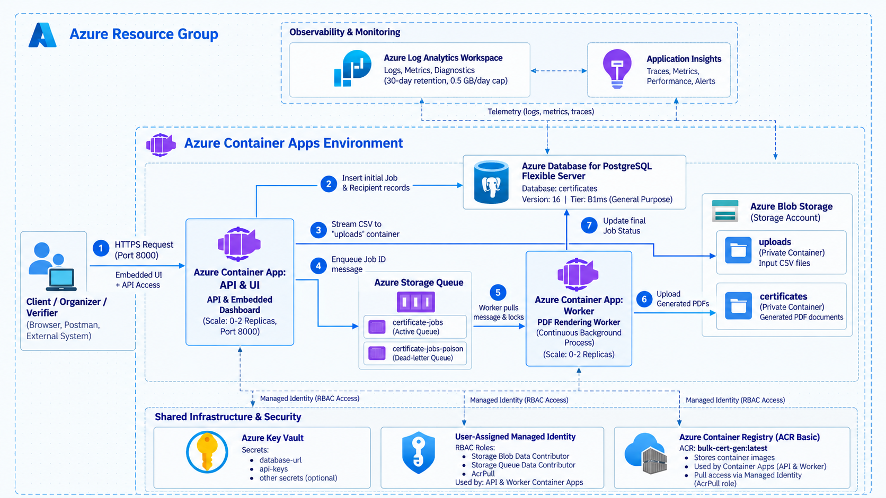
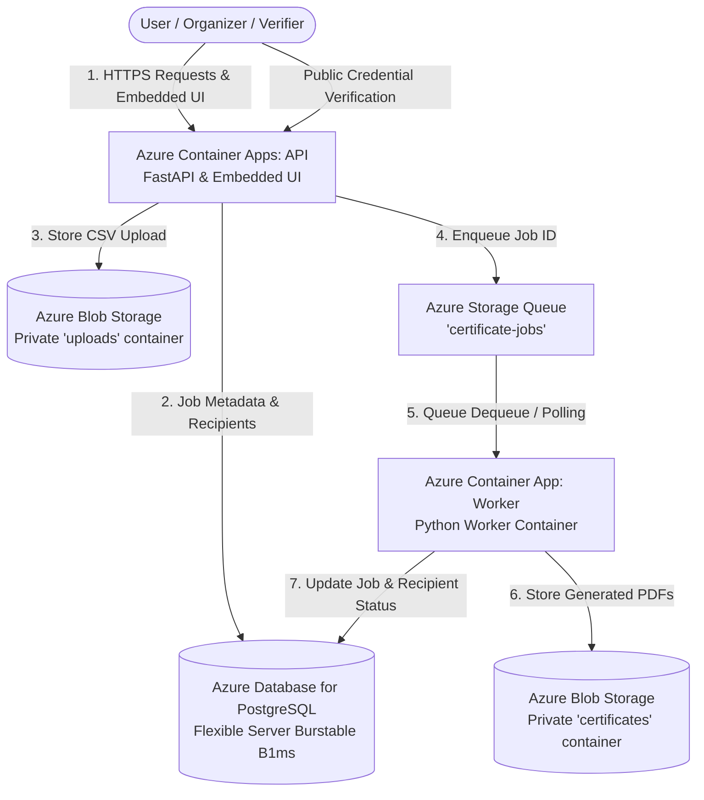
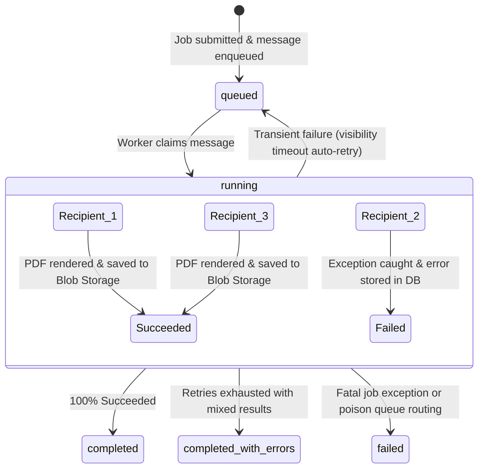

# Bulk Certificate Generator

A cloud-native, high-performance distributed platform for asynchronous bulk certificate generation, real-time progress tracking, secure PDF downloads, and public credential authenticity verification &mdash; engineered exclusively for Microsoft Azure.

<p align="left">
  
  
  
  
  
  
  
</p>

---

## Table of Contents

- [Overview](#overview)
- [Target Azure Architecture](#target-azure-architecture)
- [Core Features & Resilience](#core-features--resilience)
- [Project Structure](#project-structure)
- [Failure Isolation & Retry Semantics](#failure-isolation--retry-semantics)
- [Security & Managed Identity](#security--managed-identity)
- [Azure Infrastructure & Deployment (Terraform)](#azure-infrastructure--deployment-terraform)
- [API Reference & Usage](#api-reference--usage)
- [Cost Optimization & Low-Cost Design](#cost-optimization--low-cost-design)

---

## Overview

Generating hundreds or thousands of high-resolution PDF certificates synchronously during an HTTP request causes gateway timeouts (`504 Gateway Timeout`), memory spikes, and partial batch failures.

1. **Azure Container Apps (API & UI)**: Hosts the FastAPI application which serves both the embedded frontend dashboard and REST API endpoints over external HTTPS ingress (port 8000), scaling to zero when idle.
2. **Fast Request Validation**: Validates uploaded recipient CSV files and metadata in milliseconds, archives the CSV to **Azure Blob Storage**, records initial job state in **Azure PostgreSQL**, and enqueues a durable message in **Azure Storage Queue**, returning an immediate `202 Accepted` response.
3. **Azure Container Apps (Worker)**: Dedicated queue worker container in the same Container Apps Environment that polls messages, renders vector PDFs via **ReportLab**, persists them to Azure Blob Storage, and records statuses in PostgreSQL.
4. **Per-Recipient Isolation**: Failure on an individual recipient row never halts or invalidates valid certificates in the batch.
5. **Azure-Native Security & Cost Efficiency**: Uses Managed Identities and Key Vault instead of hardcoded secrets, and scales compute to zero when idle.

---

## Azure Architecture



### End-to-End Processing Workflow



1. **Submission**: User accesses the dashboard or submits certificate metadata (title, course, organization, issue date) and recipient CSV directly to `POST /jobs` on the Container App API.
2. **Storage & Queueing**: API streams CSV to Blob Storage `uploads/{job_id}/recipients.csv`, creates `Job` and `Recipient` records in PostgreSQL with status `queued`, and enqueues `{"job_id": "<uuid>"}` to Azure Storage Queue `certificate-jobs`.
3. **Event-Driven Compute**: Azure Container App Worker polls the Storage Queue for work items.
4. **Batch Generation**: Worker claims message with a visibility timeout, renders PDF certificates with ReportLab, uploads each to `certificates/{job_id}/{certificate_id}.pdf`, and updates row-level statuses in PostgreSQL.
5. **Completion & Draining**: If all recipients succeed, job becomes `completed`. If some rows fail, job transitions to `completed_with_errors`. Worker acknowledges and deletes the queue message. Repeatedly failing messages are diverted to `certificate-jobs-poison`.
6. **Download & Verification**: Clients download PDFs via `GET /certificates/{id}` and verifiers check credentials publicly via `GET /certificates/{id}/verify`.

---

## Core Features & Resilience

- **Serverless Scale-to-Zero API**: The API runs on Azure Container Apps Consumption plan and automatically scales to 0 replicas when there is no incoming traffic ($0 compute when idle).
- **Embedded Frontend**: Static dashboard files (`index.html`, `style.css`, `app.js`) are directly mounted and served by the FastAPI container at `/`, avoiding separate hosting costs.
- **Pure-Python Vector PDFs**: Uses ReportLab for high-performance, deterministic vector PDF rendering with dynamic typography and auto-scaling.
- **Per-Recipient Failure Isolation**: Errors in individual rows are recorded in `recipients.error` without crashing the batch.
- **Queue Retries & Poison Handling**: Bounded dequeue retries (default 3). Poison messages automatically divert to `certificate-jobs-poison` with error telemetry.
- **Multi-Tenant Scoping**: Administrative endpoints (`POST /jobs`, `GET /jobs/{id}`) require an `X-Api-Key` header mapped to tenant IDs.
- **Public Credential Verification**: Public endpoint (`GET /certificates/{id}/verify`) allows instant third-party validation without authentication.
- **Operational Health Probes**: `/health` (liveness) and `/ready` (verifies live connectivity to PostgreSQL and Azure Storage Queue).

---

## Project Structure

```text
bulk-certificate-generator/
├── app/
│   ├── certificates/
│   │   ├── routes.py          # PDF download and public verification routes
│   │   ├── schemas.py         # Verification response schemas
│   │   ├── service.py         # Per-recipient rendering & isolated error handling
│   │   ├── storage.py         # Azure Blob Storage abstraction with path-traversal sanitization
│   │   └── template.py        # ReportLab vector certificate layout engine
│   ├── core/
│   │   ├── auth.py            # API key authentication & sliding-window rate limiter
│   │   └── config.py          # Pydantic environment configuration
│   ├── db/
│   │   ├── models.py          # SQLAlchemy models (Job, Recipient, Certificate)
│   │   ├── repo.py            # Async PostgreSQL database repository queries
│   │   └── session.py         # Async engine lifecycle & session dependency
│   ├── jobs/
│   │   ├── csv.py             # CSV sanitization, bounds checking, and validation
│   │   ├── routes.py          # Job creation & status polling endpoints
│   │   ├── schemas.py         # Job request & response schemas
│   │   └── status.py          # Progress metrics & recipient result models
│   ├── queue/
│   │   └── client.py          # Azure Storage Queue & in-memory queue clients
│   ├── worker/
│   │   ├── main.py            # CLI entrypoint for Azure Container Apps Job
│   │   ├── queue_worker.py    # Queue polling loop, retry logic & poison router
│   │   └── tasks.py           # Core batch execution & progress state machine
│   └── main.py                # FastAPI entrypoint, CORS & readiness probe
├── frontend/                  # Frontend dashboard (served directly by FastAPI at /)
│   ├── index.html             # Batch generator and verifier UI
│   ├── style.css              # Modern glassmorphism dark mode styles
│   └── app.js                 # Polling logic, drag-and-drop & API calls
├── infra/                     # Infrastructure as Code (Terraform)
│   ├── main.tf                # Repeatable provisioning of all Azure resources
│   ├── variables.tf           # Input variables for environment, region, and credentials
│   ├── outputs.tf             # Output values (URLs, endpoints, IDs)
│   ├── versions.tf            # Terraform and provider constraints (azurerm ~> 4.0)
│   └── terraform.tfvars.example # Sample variable configurations
├── sample-data/
│   └── recipients.csv         # 50-row recipient dataset for test batches
├── Dockerfile                 # Multi-stage container image using Astral uv
├── pyproject.toml             # Python dependencies and project metadata
└── README.md                  # Comprehensive architectural documentation
```

---

## Failure Isolation & Retry Semantics



- **Isolated Error Boundaries**: Each recipient row is wrapped in a dedicated `try...except` block in `app/certificates/service.py`. If one recipient has invalid characters, only that recipient is marked `FAILED` with details recorded in `recipients.error`.
- **Idempotency**: On retry or redelivery, already-completed recipients (`status == COMPLETED`) are skipped immediately without re-rendering or re-uploading.
- **Bounded Dequeue & Poison Routing**: Azure Storage Queue tracks `dequeue_count`. If a job fails more than `WORKER_MAX_RETRIES` (default 3), it is moved to `certificate-jobs-poison` and the database state transitions to `completed_with_errors` or `failed`.

---

## Security & Managed Identity

- **Zero Hardcoded Secrets**: Azure Container Apps access Azure Blob Storage, Azure Storage Queue, and Azure Key Vault via **User-Assigned Managed Identity** with least-privilege RBAC:
  - `Storage Blob Data Contributor` on the Storage Account
  - `Storage Queue Data Contributor` on the Storage Account
  - `Key Vault Secrets User` on Key Vault
  - `AcrPull` on Container Registry
- **Private by Default**: Storage Account containers (`uploads`, `certificates`) forbid public anonymous access. Files are accessed via authenticated API streaming or short-lived signed URLs.
- **Network Boundaries**: PostgreSQL Flexible Server firewall rule is restricted to internal Azure IP addresses (`0.0.0.0`). Public direct access is disallowed.
- **Path Traversal Protection**: Storage abstraction validates all keys against directory traversal attacks (`..`, `\`, `:`).

---

## Azure Infrastructure & Deployment (Terraform)

The complete cloud infrastructure is defined as repeatable Infrastructure as Code (IaC)

### 💡 Resource Sizing & Cost Optimization

Every Azure service is selected for high operational efficiency and scale-to-zero / low-cost tiers:

| Resource | Configuration in Terraform | Cost Optimization Rationale |
| :--- | :--- | :--- |
| **PostgreSQL Flexible Server** | `sku_name = "B_Standard_B1ms"`, `storage_mb = 32768` (32 GB) | Burstable B1ms tier minimizes compute overhead (~$15/mo) |
| **Azure Container Apps (API & UI)** | `min_replicas = 0`, `cpu = 0.25`, `memory = "0.5Gi"` | Scales to 0 when idle ($0 compute when not in use) |
| **Worker Container App** | `min_replicas = 1`, `cpu = 0.25`, `memory = "0.5Gi"` | Minimal compute footprint for continuous queue work |
| **Azure Key Vault** | `sku_name = "standard"`, Access Policies via Managed Identity | Negligible per-transaction billing (~$0.03 / 10k ops) |
| **Log Analytics & App Insights** | `retention_in_days = 30`, `daily_quota_gb = 0.5` | 30-day retention with strict daily cap prevents bill shocks |
| **Azure Storage Account** | `account_tier = "Standard"`, `account_replication_type = "LRS"` | Standard LRS provides low-cost, durable redundancy |
| **Container Registry (ACR)** | `sku = "Basic"` | Lowest fixed-tier container registry (~$5/mo) |

---

### 🗺️ Provisioned Azure Resources

1. **`azurerm_resource_group.main`**: Dedicated resource group (`certgen-rg-${environment}-${random_suffix}`).
2. **`azurerm_user_assigned_identity.main`**: Managed identity for secure, passwordless authentication across storage, queues, and container registry.
3. **`azurerm_storage_account.main`**:
   - **Private Blob Containers**: `uploads` (CSV recipient files) and `certificates` (rendered PDFs).
   - **Storage Queues**: `certificate-jobs` (active processing queue) and `certificate-jobs-poison` (dead-letter queue).
4. **`azurerm_postgresql_flexible_server.main`**:
   - PostgreSQL 16 on Burstable `B_Standard_B1ms` with 32 GB storage.
   - Internal Azure firewall rule (`0.0.0.0`) permitting Container Apps access.
   - Database: `certificates`.
5. **`azurerm_key_vault.main`**:
   - Standard Key Vault storing `database-url`, `api-keys`, and `storage-connection-string`.
   - Access policies granted to User-Assigned Managed Identity.
6. **`azurerm_container_registry.main`**: ACR Basic tier for hosting the Docker container image.
7. **Role Assignments (RBAC)**:
   - `Storage Blob Data Contributor` (read/write uploads and certificates)
   - `Storage Queue Data Contributor` (enqueue/dequeue messages)
   - `AcrPull` (allows Container Apps to pull images from ACR)
8. **Observability**:
   - **`azurerm_log_analytics_workspace.main`**: Centralized log sink (30-day retention, 0.5 GB/day safety cap).
   - **`azurerm_application_insights.main`**: Workspace-based APM for application traces and telemetry.
9. **`azurerm_container_app_environment.main`**: Serverless Consumption environment forwarding all system and console logs to Log Analytics.
10. **`azurerm_container_app.api`**:
    - FastAPI app with external HTTPS ingress on port 8000, CORS, and health probes (`/health`, `/ready`).
    - Directly mounts and serves the embedded frontend dashboard (`/`).
    - Scaled: 0 to 2 replicas ($0 compute when idle).
11. **`azurerm_container_app.worker`**:
    - Queue worker container app consuming messages from Azure Storage Queue `certificate-jobs`.
    - Scaled: 1 to 2 replicas.

---

### 🚀 Deployment Steps (Targeted ACR Bootstrap)

> **Important**: Azure Container Apps requires the container image to exist in ACR *before* provisioning. We deploy ACR first, build and push the application image using Azure Cloud Builder, and then provision the remaining infrastructure.

#### 1. Authenticate with Azure CLI

```powershell
az login
```

#### 2. Configure Variables (`infra/terraform.tfvars`)

Ensure `infra/terraform.tfvars` exists (it is git-ignored to protect secrets):

```hcl
environment       = "dev"
location          = "eastus" # e.g. eastus, koreacentral, westeurope
app_prefix        = "certgen"
db_admin_user     = "certadmin"
db_admin_password = "YourStrongPassword123!"
api_keys          = "key1:user-admin"
```

_Alternatively, secrets can be provided via PowerShell environment variables:_

```powershell
$env:TF_VAR_db_admin_password = "YourStrongPassword123!"
$env:TF_VAR_api_keys = "key1:user-admin"
```

#### 3. Initialize & Deploy with Targeted ACR Bootstrap

```powershell
cd infra

# Initialize Terraform plugins
terraform init

# Step A: Provision Azure Container Registry first
terraform apply -target=azurerm_container_registry.main -auto-approve

# Step B: Build and push the application image to ACR using Azure Cloud Builder (no local Docker required)
$ACR_NAME = terraform output -raw acr_name
az acr build --registry $ACR_NAME --image bulk-cert-gen:latest ..

# Step C: Deploy all remaining infrastructure (Database, Key Vault, Container Apps)
terraform apply
```

---

### 🧹 Cost-Saving Operations

- **Automatic Scale-to-Zero**: Your API automatically scales down to 0 replicas when there is no incoming traffic ($0 compute when idle).
- **Stop Database When Inactive**: When not actively testing, you can pause the PostgreSQL server to save compute costs:
  ```powershell
  az postgres flexible-server stop --name <postgres-server-name> --resource-group <resource-group-name>
  ```
- **Tear Down Everything**: When finished with testing or the project, destroy all resources in one command:
  ```powershell
  cd infra
  terraform destroy -auto-approve
  ```

---

## API Reference & Usage

Once deployed to Azure, obtain the public endpoint from Terraform outputs:

```powershell
$API_URL = (cd infra; terraform output -raw api_url)
$API_KEY = "key1:user-admin" # as configured in infra/terraform.tfvars
```

### 1. Submit a Generation Job

```powershell
curl.exe -X POST "$API_URL/jobs" `
  -H "X-Api-Key: $API_KEY" `
  -F "title=Certificate of Completion" `
  -F "course=Azure Solutions Architecture" `
  -F "org=Cloud Academy" `
  -F "issue_date=2026-10-15" `
  -F "recipients_file=@sample-data/recipients.csv"
```

**Response (`202 Accepted`)**:

```json
{
  "job_id": "91e68292-8ef2-4fe9-9def-0f7a138c9d5c",
  "status": "queued",
  "total": 50,
  "status_url": "/jobs/91e68292-8ef2-4fe9-9def-0f7a138c9d5c"
}
```

### 2. Poll Job Status & Results

```powershell
curl.exe "$API_URL/jobs/91e68292-8ef2-4fe9-9def-0f7a138c9d5c" `
  -H "X-Api-Key: $API_KEY"
```

**Response (`200 OK`)**:

```json
{
  "job_id": "91e68292-8ef2-4fe9-9def-0f7a138c9d5c",
  "status": "completed",
  "total": 50,
  "done": 50,
  "success": 50,
  "failed": 0,
  "results": [
    {
      "row": 2,
      "name": "Dev Mishra",
      "status": "completed",
      "error": null,
      "certificate_id": "d0dc9cdc-b4af-4ecb-81c8-9f71494f0aad",
      "download_url": "/certificates/d0dc9cdc-b4af-4ecb-81c8-9f71494f0aad",
      "verification_url": "/certificates/d0dc9cdc-b4af-4ecb-81c8-9f71494f0aad/verify"
    }
  ]
}
```

### 3. Download Certificate PDF

```powershell
curl.exe -L "$API_URL/certificates/d0dc9cdc-b4af-4ecb-81c8-9f71494f0aad" `
  --output certificate.pdf
```

### 4. Verify Certificate Authenticity (Public)

```powershell
curl.exe "$API_URL/certificates/d0dc9cdc-b4af-4ecb-81c8-9f71494f0aad/verify"
```

**Response (`200 OK`)**:

```json
{
  "valid": true,
  "certificate_id": "d0dc9cdc-b4af-4ecb-81c8-9f71494f0aad",
  "recipient_name": "Dev Mishra",
  "course": "Azure Solutions Architecture",
  "org": "Cloud Academy",
  "issue_date": "2026-10-15",
  "issued_at": "2026-10-15T10:15:30.123456Z"
}
```

---

## Cost Optimization & Low-Cost Design

The architecture minimizes monthly cloud spend by selecting consumption-based, scale-to-zero tiers:

| Component              | Selected Azure SKU                            | Cost Optimization Rationale                                    |
| ---------------------- | --------------------------------------------- | -------------------------------------------------------------- |
| **API & Frontend**     | Azure Container Apps `Consumption`            | Serves API & embedded dashboard; scales to 0 replicas ($0 idle)|
| **Worker**             | Azure Container Apps `Consumption` (Continuous)| 0.25 vCPU / 0.5Gi minimal compute footprint                     |
| **Queue**              | Azure Storage Queue                           | ~$0.0004 per 10,000 operations (eliminates ~$16+/mo Redis)     |
| **File Storage**       | Azure Blob Storage `Standard_LRS Hot`         | ~$0.018 per GB/mo; private containers                          |
| **Database**           | PostgreSQL Flexible `Standard_B1ms` Burstable | Lowest tier (~$15/mo) with 32 GB storage                       |
| **Container Registry** | Azure Container Registry `Basic`              | Lowest fixed-tier registry (~$5/mo)                            |
| **Secrets**            | Azure Key Vault `Standard`                    | Negligible per-operation cost (~$0.03 per 10,000 ops)          |
| **Monitoring**         | Log Analytics `PerGB2018` (30 days)           | Retains logs for 30 days to prevent ballooning storage charges |
